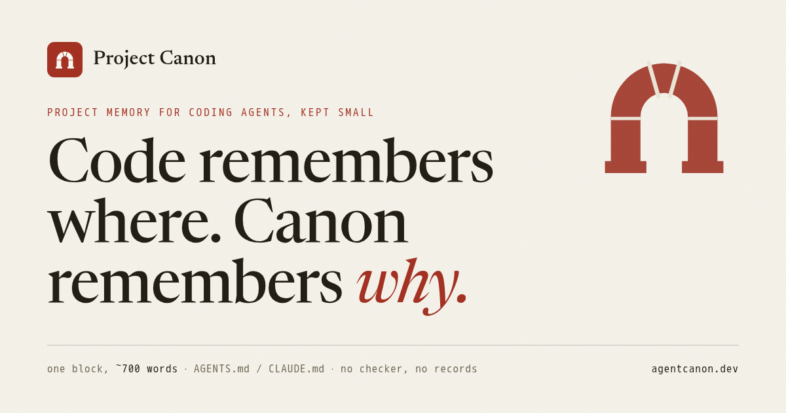

<div align="center">

# Project Canon

**A handful of notes holding what code, tests and git cannot tell your agents.**

*Code remembers where. Canon remembers why.*


[](https://agentcanon.dev)

<a href="https://agentcanon.dev">
  
</a>

</div>

Every fresh agent session rebuilds its picture of your system from code. Most
of what it needs is there: behavior in the code, limits in the tests, the
reason for a change in its commit. A few things are not: a guarantee two
services both rely on, a gap the owner accepted on purpose, an approach that
was measured and dropped. Project Canon is one block of rules for your
`AGENTS.md` or `CLAUDE.md` that tells agents where each kind of knowledge
belongs, and keeps the few notes in `canon/` small, current and subordinate to
the owner.

## Why it looks like this

An earlier Canon asked for much more: a manifest read at every session start,
front matter with `sources`/`verified` stamps, immutable decision records,
per-feature specs, a checker. One adopter ran it at production scale:

- in its last 30 days, `canon/` was touched in 488 of 639 commits, and about
  half of all canon file touches were `verified:` stamp bumps;
- at migration it held 384 files, about 200k words and 272 decision records;
- a typical fix was estimated, from document sizes, to read about 23k tokens
  of canon before any code;
- an "immutable" approval record caused a finished piece of work to be
  reverted 18 minutes after it landed;
- specs that copied the code drifted, down to wrong production defaults.

That canon is now four notes. The current rules are written so no adopter ends
up there again.

## The rules, in short

- **Nothing up front.** The instruction file is the only session-start
  context. A task that touches a cross-module guarantee, a production
  operation or a previously tried approach runs `ls canon/` and reads the note
  whose name matches. A code-only task reads none.
- **The owner wins.** The owner's current instruction outranks every note. If
  a note disagrees, the agent says so once, does what was asked, and fixes or
  deletes the note in the same change. Only the owner's words make a rule; an
  agent never records its own choices as "must" or "never".
- **No decision records.** No `decisions/` directory, log, register or ADR. A
  decision's reason and the rejected alternative go in the commit body; if it
  constrains future work in a way code cannot show, one clause goes in the
  document it constrains. A reversal edits that clause in place.
- **No stamps, no index.** No front matter, status fields, `sources`/`verified`
  metadata, review dates, manifest or changelog.
- **Write only when something became false.** A change must fix or delete
  every Canon sentence it makes false. Moves, renames and refactors oblige
  nothing.
- **Small by rule, not by tooling.** `canon/` is flat, at most twelve notes of
  about a thousand words, unless the owner sets other numbers. At the limit, a
  note is added only by removing or merging one. There is no checker.

## Where knowledge goes

| Knowledge | Home |
|---|---|
| How to work here | the instruction file, in the owner's words |
| Behavior, limits, formats, error cases | code, and a test named for the behavior |
| Why this code is odd, what was tried here | a comment at that code |
| Why a change was made, what was rejected | the commit body |
| How to operate, deploy or recover | the runbook beside the tool |
| A guarantee spanning several owners, an accepted gap, a measured dead end | a Canon note |
| An owner-approved plan for unbuilt work | a Canon note, deleted once built |
| Handovers and session notes | `canon/scratch/`, git-ignored and never cited |

The exact text is [canon-core.md](canon-core.md), about 700 words.

## Quick start

```sh
(
  set -eu
  for f in AGENTS.md CLAUDE.md; do
    if test -e "$f" || test -L "$f"; then
      echo "$f exists: merge the block instead (INSTALL.md, managed merge)" >&2
      exit 1
    fi
  done
  tmp="$(mktemp -d)"
  trap 'rm -rf "$tmp"' EXIT
  git clone --depth 1 https://github.com/stefan-vatov/canon "$tmp/canon"
  cp "$tmp/canon/dist/AGENTS.md" AGENTS.md
  printf '@AGENTS.md\n' > CLAUDE.md   # omit if Claude Code does not work here
)
```

It runs in a subshell, so a refusal does not close your terminal. It checks
both files before writing either, clones into a fresh temporary directory
that is removed on exit, and writes nothing if either file already exists. The copied `AGENTS.md` is a managed block between
`<!-- BEGIN PROJECT CANON -->` markers: put your project's own rules above or
below it in the same file, and upgrades replace only the block. Claude Code
alone can take `dist/CLAUDE.md` as its `CLAUDE.md` instead; with more than one
agent, keep the one copy in `AGENTS.md` and import it. For an existing
instruction file, use the managed merge in [INSTALL.md](INSTALL.md); it also
covers upgrade, rollback and uninstall.

Then bootstrap in a fresh session from the target repository:

```text
Set up Project Canon in this repository now. Preserve all existing repository
instructions. Create canon/ and add canon/scratch/ to the repository-root
.gitignore without removing existing entries. Write no notes. Report what you
changed.
```

An empty Canon is healthy. A note arrives when a task needs one and the owner
agrees.

### Migrating an older canon

If the repository already has a canon with decision records, a manifest,
stamps or specs, the [`compact-canon`](.codex/skills/compact-canon/SKILL.md)
skill migrates it once, the way the adopter above was migrated: tag first,
instructions first, runbooks beside their tools, citations repointed, decision
records deleted after their live rules move, specs that copy code deleted,
review against the tag. Ask it for a `dry run` first; it measures churn,
stamp-only touches and startup reads, and changes nothing.
[INSTALL.md](INSTALL.md#migrate-a-canon-built-under-older-rules) has the
steps. Remove the skill afterwards.

## Evidence

The rules changed because of the field numbers above, not because of an eval
win. The earlier core passed this repository's own lab, which rewarded
manifest routing, decision records and immutable predecessors: the very
behaviors that cost the adopter most. Those scores are kept in
[BASELINES.md](evals/BASELINES.md), marked as measuring the retired core.

The lab now tests the current rules in fifteen scenarios, including a stated
decision that must leave no record, a reversal edited in place, an owner
instruction that overrides a note's "never" rule, a falsified sentence fixed
unprompted, a code-only task that must read no Canon, an agent-written brief
whose "always/never" lines must not become rules, and a new guarantee that
arrives at the note budget. Each run gets mechanical checks, with hidden
holdout tests in most scenarios, and a separate judge score. The new set has not yet been run
against live models, so no score is claimed. The harness, scenarios, rubric
and playbook are in [evals/](evals/README.md).

## What Canon is not

- **Not a mirror of the code.** Limits, defaults, status codes, field lists
  and file inventories stay in code and tests, where they cannot drift.
- **Not a decision log or a changelog.** Git is the history:
  `git log -S`, `git log --grep`.
- **Not a reading obligation.** Nothing in `canon/` is read at session start.
- **Not a gate.** Nothing runs in hooks or CI; the rules act at the moment of
  writing.
- **Not a guarantee.** Adherence is measured per model, not assumed.

## Supported integrations

| Agent or harness | Source | Default destination |
|---|---|---|
| Codex, Pi, or another `AGENTS.md` reader | `dist/AGENTS.md` | `AGENTS.md` |
| Claude Code | `dist/AGENTS.md` imported from `CLAUDE.md`, or `dist/CLAUDE.md` | `CLAUDE.md` |

Both artifacts contain the same generated block between
`<!-- BEGIN PROJECT CANON -->` and `<!-- END PROJECT CANON -->` markers,
ending with a small, removable provenance link to Project Canon. Pi 0.83 and later loads a project
`AGENTS.md` natively.

## Maintain this repository

`canon-core.md` is the source of both generated artifacts under `dist/`. After
changing it:

```sh
uv run --script tools/build.py
uv run --script tools/build.py
PYTHONDONTWRITEBYTECODE=1 \
  uv run python -m unittest discover -s tests -p 'test_*.py' -v
git diff --check
```

The second build must report both artifacts as `fresh`. Measure a core change
with [evals/PLAYBOOK.md](evals/PLAYBOOK.md) before adopting it, and check it
against a real adopter's churn and startup reads.

The website is maintained here too: `npm install` once, `npm run dev` to
preview, `npm run build` to build into `dist-site/` (never `dist/`, which holds
the generated artifacts), and `npx wrangler deploy` to publish, which requires
Cloudflare access to the agentcanon.dev zone.

## Documentation

- [INSTALL.md](INSTALL.md): installation, merge, migration, upgrade, rollback
  and uninstall.
- [canon-core.md](canon-core.md): the exact shared block.
- [evals/README.md](evals/README.md): evaluation harness and scenarios.
- [evals/PLAYBOOK.md](evals/PLAYBOOK.md): improvement and adoption runbook.
- [evals/BASELINES.md](evals/BASELINES.md): evaluation adoption ledger.

Project Canon is MIT licensed and originated as a fork of
[fjzeit's concept](https://github.com/fjzeit/lode).

---

**Companion project:** [Agent Constitution](https://agentconstitution.dev)
([repo](https://github.com/stefan-vatov/agentconstitution)): the law your
agents build under, where Canon is the record they build on. The constitution
governs direction and values; Canon keeps the few cross-owner guarantees and
the reasons behind them.
